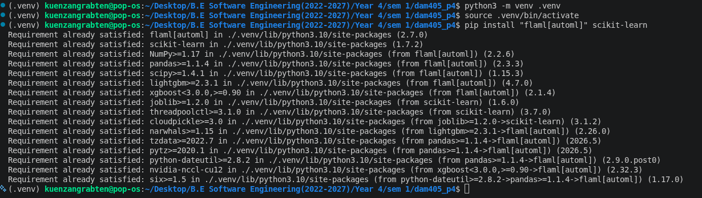
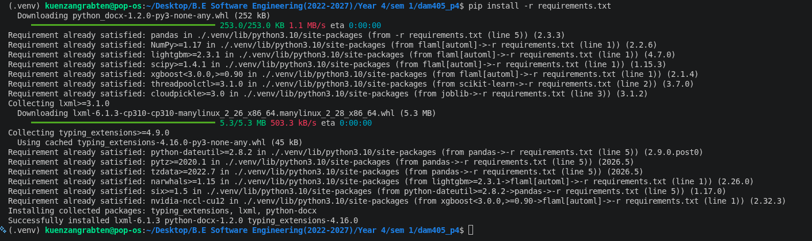
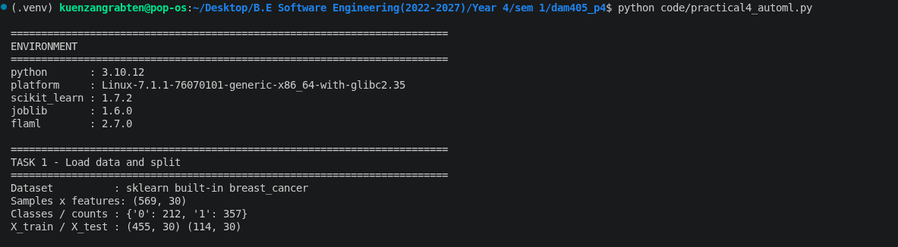
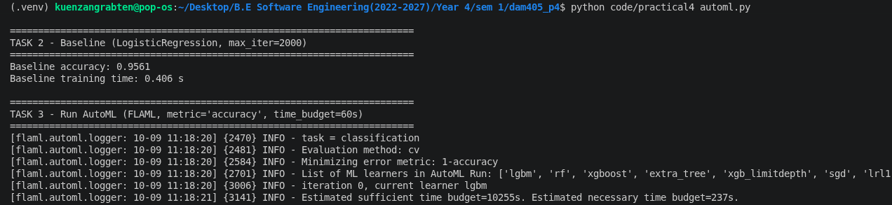
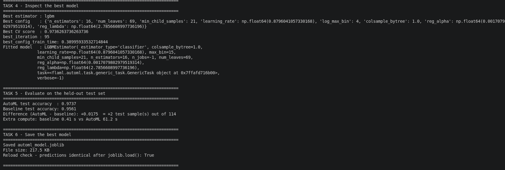

# DAM405 · Practical 4 - Automated Training & Tuning with FLAML


Goal: use the open-source AutoML library **FLAML** to train and tune a classifier within a time budget, compare it with a plain baseline, inspect the best model, and save it.


| Item | Status 
|---|---|
| Baseline (Tasks 1-2), real numbers | **Done.** LogisticRegression test accuracy = **0.9561** (109/114); scaled variant = 0.9737. Stored in `outputs/results.json`. |
| FLAML AutoML run (Tasks 3-6) | **You must run it.** FLAML could not be installed in the workspace where this package was prepared (PyPI was blocked), so no AutoML numbers were produced or invented. |
| `report/DAM405_Practical4_Report.docx` | **Draft.** Everything is written; AutoML values and screenshots show as yellow / grey placeholders until you run step 4 below. |
| Script logic | Tested end to end against a stand-in module, so the control flow, JSON output, joblib save/reload and report generation are verified. Only real FLAML is untested. |

## Folder contents

```
dam405_p4/
├── README.md                     <- this file
├── requirements.txt
├── code/
│   ├── practical4_automl.py      <- runs Tasks 1-6 (+ optional experiments)
│   └── build_report.py           <- builds the Word report from real results
├── notebooks/practical4_automl.ipynb   <- same experiment, one cell per task (Colab/Jupyter)
├── outputs/                      <- results.json, model, logs are written here
├── screenshots/                  <- put your screenshots here (names below)
└── report/DAM405_Practical4_Report.docx
```

## What to do 

Python 3.9+ is needed. Run every command from the project root (`dam405_p4/`).

### Step 1 - Set up and install (Task 1)
```bash
python -m venv .venv
source .venv/bin/activate          # Windows: .venv\Scripts\activate
pip install "flaml[automl]" scikit-learn
pip install -r requirements.txt    # joblib, python-docx, pandas
```




### Step 2 - Run the required tasks (Tasks 1-6)
```bash
python code/practical4_automl.py
```






### Step 3 - Optional experiments (the sheet's "Optional" box)
```bash
python code/practical4_automl.py --extras
```

### Step 4 - Build the report
Save the screenshots (table below), then:
```bash
python code/build_report.py --name "Kuenzang" --student-id YOUR_ID
```
This overwrites `report/DAM405_Practical4_Report.docx` with all real numbers, the written answers to the three reflection questions, and your screenshots. The yellow DRAFT box disappears. Open the file and read it once.


## Using your own dataset
```bash
python code/practical4_automl.py --data path/to/data.csv --target label_column --extras
```
The split, baseline and AutoML settings stay identical. Update the "Dataset" paragraph in Section 2.4 of the report by hand.


## Submission checklist
- [ ] `pip install` worked and fig01 saved
- [ ] `python code/practical4_automl.py --extras` finished with "DONE"
- [ ] `outputs/automl_model.joblib` exists
- [ ] Screenshots fig01-fig07 saved (fig08 optional)
- [ ] `python code/build_report.py --name … --student-id …` run; no yellow text left in the docx
- [ ] Read the reflection answers; edit any wording you disagree with, in your own voice
- [ ] Submit in the format the tutor prescribes (Word file, or export to PDF if asked) before the next practical class

## Troubleshooting
- **`FLAML is not installed`**  run Step 1 in the same environment you run the script from.
- **Different numbers on every run**  expected: the search is limited by wall-clock time, so the number of trials depends on your machine. Report your own run's numbers.
- **`ConvergenceWarning`**  expected for the plain baseline; discussed in the report.
- **Report still shows yellow text**  `outputs/results.json` has no AutoML section yet; run Step 2 or 3 first.
- **`python` not found**  try `python3`.
# AS2025_DAM405_02230289_practical4
